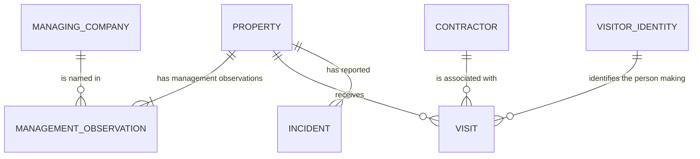

# Understanding the business and the data

Everything here is fictional. You do not need experience with Onside or a farm
management product. This guide explains the source records and their business
relationships; you choose how to implement the analytics models.

## A typical day

A property is a physical site, such as a farm or orchard. A managing company is
responsible for that site. It hires a contractor organisation to carry out work.
A person working with that contractor arrives, records a visit and later records
their departure. Someone may separately report an incident at the property.

The manager wants to understand activity across their sites and contractors.
The exports capture that activity, subsequent corrections and management changes.

## The main concepts

| Concept | Meaning in this project | Where it appears |
| --- | --- | --- |
| Property | A physical site with a name and local timezone | `properties.csv`, identified by `property_id` |
| Managing company | An organisation responsible for a property during a period; this describes management responsibility, not legal ownership | `companies.csv`, identified by `company_id` |
| Contractor | An organisation or crew carrying out work at a site; separate from its managing company | `contractors.csv`, identified by `contractor_id` |
| Visitor | One person, represented only by an opaque ID; the same person can make many visits | `visitor_id` in visit payloads; there is no visitor-profile file |
| Visit | One person's attendance at one property, associated with one contractor, with a start and possibly an end | Reconstructed from change events sharing a `visit_id` |
| Incident | A separately reported event at a property, categorised as low, medium or high severity | `incidents.csv`, identified by `incident_id` |
| Management observation | A source statement that a company manages a property from an effective time; several observations can describe the same unchanged manager | `property_management.csv`, identified by `observation_id` |

Meadow Operations is the fictional audience for the reporting project. It is not
an additional row to create in `companies.csv`; that file lists the three managing
organisations. A managing company can be responsible for several properties.

## How the business records relate

For valid records, these relationships apply. Some supplied visit references are
deliberately invalid and need to be identified during your quality checks.

`VISIT` above is a business record reconstructed from the exports.
`VISITOR_IDENTITY` represents a repeated ID, not a supplied table you need to find.
The diagram does not prescribe your database schema. In words:

| Relationship | How to interpret it in the files |
| --- | --- |
| Property → visits | A property can receive many visits; each visit refers to one `property_id` |
| Contractor → visits | A contractor can have many visits at many properties; each visit has one `contractor_id` |
| Visitor → visits | A person can make many visits, including at different properties; repeated `visitor_id` values identify the same person |
| Property → incidents | A property can have many incidents; each incident has one `property_id` |
| Property → management history → company | Match the property and the time of the visit or incident to the effective management state |

A visit has no direct `company_id`. You determine its managing company through
the property's management history. The same applies to incidents. A property
has one manager at any instant, but may have several different managers over time.
Contractor and company IDs describe separate roles; do not join them to each other.

There is no incident-to-visit, incident-to-person or incident-to-contractor link
in this dataset. An incident at a property cannot be assigned to a particular
visit or contractor from these files. Visit and incident totals meet at the
reporting level, such as property/week or company/week.

## Why a change event is different from a visit

One visit might first be exported when its start is known, then exported again
when its end is recorded or corrected. These are changes to one visit, not several
separate attendances.

- `visit_id` identifies the business visit throughout its life.
- `event_id` identifies an exported change; the same event may be delivered again.
- `source_version` orders the states of that particular visit. Version 2 of one
  visit has no ordering relationship to version 2 of another visit.
- A batch is a delivery file containing changes for many visits. The same visit
  can appear several times within a batch or across different batches.
- An **upsert** supplies the complete state to create or replace for a visit.
  A **delete** retracts that visit from reporting; it does not delete the property,
  the visitor's other visits or any independently reported incidents.

An unfinished visit means no end is recorded. It might represent a person who
has not departed or a missing departure record; the data does not distinguish
those explanations. It contributes to counts but not completed hours. A
non-deleted visit may already be finished: "active in the data" does not mean
the person is physically on site now.

## The different clocks

| Field | Question it answers |
| --- | --- |
| Visit `started_at` / `ended_at` | When did attendance start, and what departure time is recorded? |
| Incident `reported_at` | When was the incident reported? There is no separate occurrence-time field |
| Management `effective_at` | From when did this management state apply in the business? |
| Event `updated_at` | When does the source say it changed the visit record? |
| Manifest `snapshot_date` | Which export delivery does this batch represent? |

A correction received in April can change the recorded duration of a March
visit. Its reporting week still follows the visit start, and its managing
company still follows the management state at that start. The latest manager
today and the company responsible for an earlier visit can differ.

## Worked example

This is a small illustration with extra fictional IDs, not rows to find in the
supplied data. Example Orchard (`EX-P1`) uses `Pacific/Auckland`. Example Hill
Management manages it until `2026-03-23T00:00:00Z`, when Example Valley Management
takes over.

A person (`EX-U1`) visits for contractor Example Field Crew (`EX-K1`):

| Received record | Visit ID | Version | Start (UTC) | End (UTC) |
| --- | --- | ---: | --- | --- |
| Event EX-E1, first export | EX-V1 | 1 | 2026-03-10 20:00 | null |
| Event EX-E2, later correction | EX-V1 | 2 | 2026-03-10 20:00 | 2026-03-10 21:00 |
| Repeat delivery of EX-E2 | EX-V1 | 2 | 2026-03-10 20:00 | 2026-03-10 21:00 |

After the first export, this is one unfinished visit with no completed hours.
After the correction, it is one completed visit lasting one hour. Repeating the
correction does not create another visit. A later arrival of EX-E1 must not undo it.

The start is 11 March at 09:00 in Auckland, in the week beginning 9 March. The
visit belongs to Example Hill Management because it occurred before the transfer,
even if the correction arrives after Example Valley Management takes over.
If the same person makes another visit in that company/week, there are two visits
but one distinct visitor at company/week grain.

A separate incident at Example Orchard is counted using its own reported time.
It cannot be assumed to have happened during EX-V1 or to have been caused by
Example Field Crew.

Next, read [the project brief](README.md) for the deliverables and business rules,
and [the data dictionary](DATA_DICTIONARY.md) for exact source fields and guarantees.
